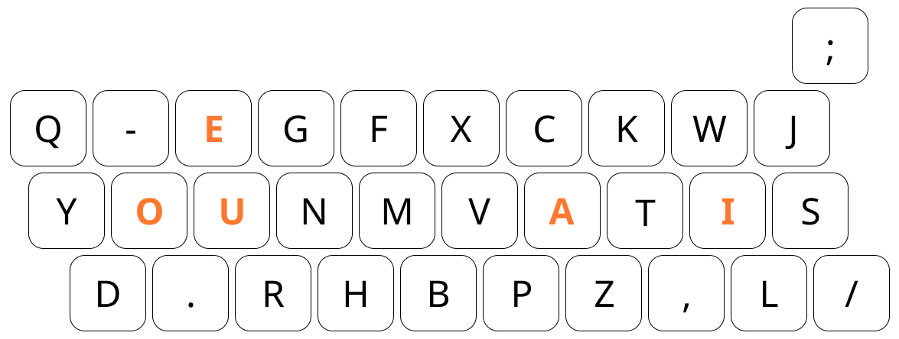
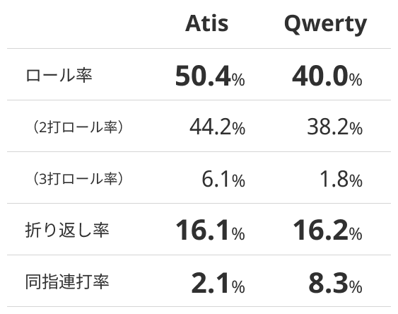
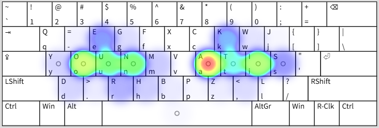

# Atis

これは[キーボード配列のつくりかた](https://tarry-form-58c.notion.site/31fbcda56bb1802f969fc3c644259cae)というサイトで、ローマ字配列の作例として公開したサンプル配列です。

想定運指など、詳細は[C/V Ratioを活用した配列作成例](https://tarry-form-58c.notion.site/C-V-Ratio-341bcda56bb180c887fbebdb642ab9f0)をご覧ください。

# 特徴

ローマ字入力に特化して、Qwerty配列と同等の折り返し率をキープしながら、ロール率を高めています。

折り返しとは、Qwerty配列でいう「YOU」や「SAT」のように、片手3打が連続しつつ、使う指の順番が切り替わるような打鍵です。比較的高度な指の独立性を求められます。

これに対して、ロールとは片手でそれぞれ異なる指の複数打鍵を行いつつ、その順番が一方向にのみ進むものを指します。例えばQwertyローマ字入力で「これ」＝「KO / RE」と打つとき、「KO」は右手2打の外向きロールで、「RE」は左手2打の外向きロールです。慣れると楽に高速打鍵できるパターンですが、これを増やそうとすると厄介な折り返しも増えてしまうというジレンマがあります。

そこで、[ローマ字の連接傾向を測るC/V Ratioの提案](https://tarry-form-58c.notion.site/C-V-Ratio-337bcda56bb18084aa5cc5e7582d2ff0)という記事でC/V Ratio（Consonant / Vowel Ratio、子音：母音比率）という指標を算出しました。これを基に、片手の連続打鍵が増えるように配字しながらも、その進行方向を統一するように工夫しました。これにより、Qwerty配列よりも10パーセントポイントほど高いロール率を実現しながらも、折り返し率を同等に抑えています。

また、Qwertyローマ字でいう「き」＝「KI」のような、同じ指の連続打鍵も大幅に減らしています。同時にホームポジション周辺キーの使用率を高め、指ごとの使用率もバランスを整えています。

# 導入方法

詳しくは[日本語新配列の実装方法](https://tarry-form-58c.notion.site/381bcda56bb180108fdfea281522524c#381bcda56bb18046ae40e7d1dc1eca5e)を参考にしてください。

## keymapper（クロスプラットフォーム）

[Releases](https://github.com/houmain/keymapper/releases)からお使いの環境に合ったものを選んでインストールし、設定ファイルを開いて、[keymapper.conf](keymap/keymapper.conf)の内容で上書き保存してください。

## AutoHotKey（Windows）

[AutoHotkey](https://www.autohotkey.com)からv2.0をインストールし、[atis.ahk](keymap/atis.ahk)をダウンロードしてダブルクリックすると置換が有効になります。タスクトレイの「Exit」で終了します。

## MSKLC（Windows）

[Microsoft Keyboard Layout Creator (MSKLC)](https://www.microsoft.com/en-us/download/details.aspx?id=102134)をインストールし、上部メニューの File > Load Source File… から[atis.klc](keymap/atis.klc)を読み込んで、Project > Build DLL and Setup Package でインストーラーを作成できます。作成されたsetup.exeを実行すると新しいレイアウトが追加され、Windowsキー + スペースなどで切り替えられるようになります。削除は通常のソフトと同じく、設定アプリの「インストールされているアプリ」一覧からアンインストールできます。

# ライセンス

[MIT](LISENSE.txt)

なお、キー配列自体に権利は発生しないはずです。各種キーマップファイルなどのライセンスがMITです。
